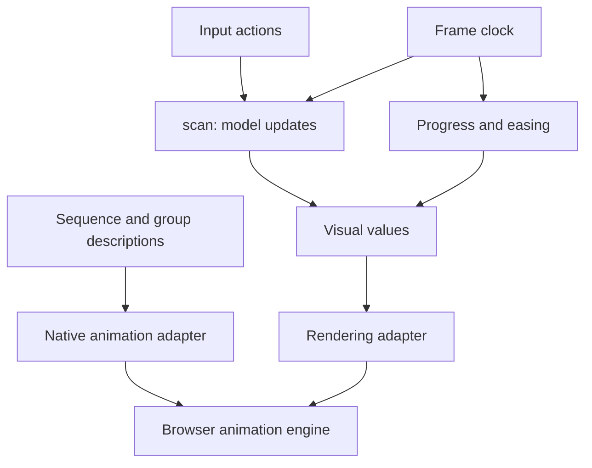

# RxJS for Animations

**Animation values, state, composition, and explicit rendering with RxJS 7.8.2.**

**Main contributor and AI co-author: ChatGPT — GPT-6 Astra (OpenAI).**  
Project owner, direction, and review: [Hans Schenker](https://github.com/hansschenker).

An animation is a stream of visual states calculated from time, inputs, and motion rules. This library turns that idea into strict, functional TypeScript: lazy clocks, progress, easing, interpolation, motion, immutable particle state, composition trees, and small browser adapters.

The animation core emits values. A renderer consumes those values. Browser effects have explicit owners and cleanup; there is no `tap` in the implementation or examples. Clock/random sampling and rendering are environmental effects—the entire application is not claimed to be pure.

## Status

**Version 0.1.0 — implemented experimental foundation.** Source, tests, a Vite demo, API contracts, and source-pinned consolidation analysis are included. The package has not been published to npm. This repository is a new consolidation; the two reference repositories remain independent.

## Try it

```bash
git clone https://github.com/hansschenker/rxjs-for-animations.git
cd rxjs-for-animations
npm ci
npm run check
npm run dev
```

The demo contains a state-driven dot trail, numeric easing, and native sequence/group animations. Its HTML, CSS, and TypeScript are separate. Reduced-motion preferences start the trail stopped and make explicitly triggered tweens/native animations immediate.

`npm run check` runs strict type checking, deterministic tests, the ESM/declaration build, and the demo production build. `npm pack` creates a local installable package. Consumers install RxJS **7.8.2** as the peer dependency.

## Three sources of inspiration

| Source | Contribution to this design |
| --- | --- |
| [Ben Lesh's rxjs-web-animation](https://github.com/benlesh/rxjs-web-animation/tree/a6771be996d051070720ee64684d721edda0a919) | Frame time → normalized duration → easing → interpolation; velocity and acceleration as value streams. Despite its name, this repository is not a native Web Animations API wrapper. |
| [Hans Schenker's rxjs-animations](https://github.com/hansschenker/rxjs-animations/tree/1b398706aaed3e2996bfba94832cf9729e416174) | Pure animation descriptions, recursive sequence/group composition, lazy native execution, and explicit connection ownership. |
| Our dot-trail exploration | Mouse/frame actions → immutable state → visual values → a keyed renderer with explicit disposal. |

See [the source review and compatibility decisions](docs/INSPIRATIONS.md). This is a new implementation, not a merged copy of the upstream packages. Their applicable attribution and license records are preserved in [NOTICE.md](NOTICE.md).

## The architecture



Both routes use RxJS to express connection lifetime and composition:

- **Frame/value route:** RxJS processes frame timestamps and calculates values. Suitable for stateful particles, custom visual models, Canvas/SVG adapters, or DOM sinks.
- **Native route:** the browser interpolates keyframes; RxJS controls when each native run starts, completes, or is cancelled. It emits one native `Animation` on successful finish, not a stream of per-frame values.

## A numeric tween

```ts
import { tween$, easeInOutCubic } from 'rxjs-for-animations';

const position$ = tween$({
  from: 0,
  to: 320,
  durationMs: 1200,
  easing: easeInOutCubic,
});

// This is the rendering boundary.
const connection = position$.subscribe(x => {
  element.style.transform = `translateX(${x}px)`;
});

// Cancels future values; it does not invent a final position.
// connection.unsubscribe();
```

Construction is lazy. Each connection begins at its own time origin. A positive duration emits the initial value synchronously and the exact target when a frame reaches the duration. Zero duration emits only the target and does not connect to a clock. Early clock completion is forwarded without manufacturing a target value.

## Interpolate any value

```ts
import { interpolate$, easeOutCubic } from 'rxjs-for-animations';

const appearance$ = interpolate$({
  durationMs: 600,
  easing: easeOutCubic,
  project: progress => ({
    x: 240 * progress,
    scale: 0.5 + 0.5 * progress,
    opacity: progress,
  }),
});
```

The user-supplied projection defines what a value means. The operator supplies progress and execution behavior. Easing is applied between the exact endpoints; a custom curve may overshoot, but must produce finite numbers.

## One explicit clock for a dot trail

```ts
import { fromEvent, map } from 'rxjs';
import {
  createAnimationClock,
  shareAnimationClock,
  createTrail$,
  createDotRenderer,
  type ParticleSeed,
} from 'rxjs-for-animations';

const clock = shareAnimationClock(createAnimationClock());

// layer is a fixed, viewport-sized overlay styled by the application.
const births$ = fromEvent<MouseEvent>(document, 'mousemove').pipe(
  map((event, id): ParticleSeed => ({
    id,
    x: event.clientX,
    y: event.clientY,
    velocityX: (Math.random() * 2 - 1) * 120,
    velocityY: (Math.random() * 2 - 1) * 120,
    bornAt: clock.now(),
  })),
);

const dots$ = createTrail$(births$, clock.frames$, {
  lifetimeMs: 1000,
  maxParticles: 500,
});

const renderer = createDotRenderer(layer);
const connection = dots$.subscribe(renderer.render);
connection.add(renderer.dispose);
```

Each particle has its own birth time while all particles can use one frame source. The trail never reads a clock or samples randomness internally. Births and frames must use the same timestamp domain. Sharing a clock shares its frame execution; sharing an entire state stream is a separate choice, such as `shareReplay({ bufferSize: 1, refCount: true })`.

The model removes expired records; the renderer removes elements no longer represented. `renderer.render([])` clears the screen while keeping the renderer usable. `renderer.dispose()` permanently releases its owned elements. Neither an inner completion nor an unsubscription magically removes unrelated DOM.

## Native plans, sequences, and groups

```ts
import {
  animationPlan, sequence, group, runAnimation$,
} from 'rxjs-for-animations';

const move = animationPlan(
  [{ transform: 'translateX(0)' }, { transform: 'translateX(100px)' }],
  { timing: { duration: 400 } },
);

const pulse = animationPlan(
  [{ opacity: 1 }, { opacity: 0.4 }, { opacity: 1 }],
  { timing: { duration: 300 } },
);

const description = sequence([
  move,
  group([move, pulse]),
]);

const connection = runAnimation$(element, description).subscribe();
// connection.unsubscribe(); // Cancels currently active native children.
```

A sequence waits for child **completion**, not its first emission. A group connects children together and waits for all of them. Nesting is preserved, errors stop the tree, and empty compositions complete immediately.

By default, native effects use `finish: 'release'`: teardown cancels the native effect even after success, returning styling to its underlying state. Set `{ finish: 'retain', timing: { fill: 'forwards', ... } }` to transfer a successful filled effect to the caller. The emitted `Animation` then needs eventual caller-owned cancellation. Native properties animated concurrently on the same element follow normal browser effect-composition rules.

## Playback is an RxJS policy

Use ordinary operators on streams of requests:

| Operator | When another request arrives |
| --- | --- |
| `mergeMap` | Start it alongside active animations. |
| `switchMap` | Close the previous animation and start the new one. |
| `concatMap` | Wait until earlier animations complete. |
| `exhaustMap` | Ignore it while the current animation is active. |

These policies do not automatically preserve a visual position on replacement. A new tween starts at its configured `from` value. Continuous retargeting, pause/resume/seek, and spring solvers require additional state policies and are not included in this release.

## Documentation and verification

- [Consolidated analysis](docs/ANALYSIS.md): intuition, contracts, time, policy, rendering, and tradeoffs.
- [API contracts](docs/API.md): public functions, units, endpoints, ownership, and errors.
- [Source inspirations](docs/INSPIRATIONS.md): pinned upstream evidence and deliberate differences.
- [Verification](docs/VERIFICATION.md): test coverage, reproducible commands, and browser validation limits.
- [Roadmap](docs/ROADMAP.md): implemented scope and subsequent work.
- [Contributors](CONTRIBUTORS.md): human direction and AI attribution.

The core is independent of React, Angular, and a particular renderer. It uses type aliases and functions, with no classes or enums. DOM and native-animation adapters are explicit effect boundaries. The package can be imported in Node without starting a browser clock.

## Attribution and license

Main implementation contributor and AI co-author: **ChatGPT — GPT-6 Astra (OpenAI)**. Project direction: **Hans Schenker**. Ben Lesh and the reference projects are credited as inspirations; this does not imply their endorsement or participation in this repository.

MIT. See [LICENSE](LICENSE), [NOTICE.md](NOTICE.md), and [CONTRIBUTORS.md](CONTRIBUTORS.md).
